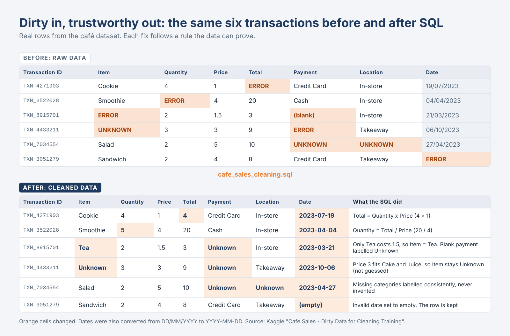
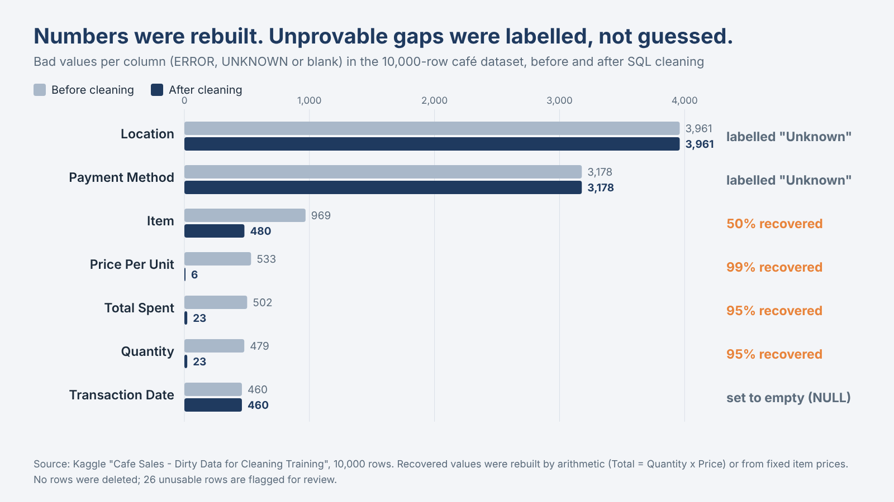

# Cleaning 10,000 Café Transactions with SQL and Excel

A portfolio project that takes a deliberately messy dataset and turns it into a trustworthy dashboard. Every bad value was either recovered from the data itself, labelled as unknown, or flagged. No rows were deleted.

**Tools:** SQL (SQLite, DB Browser) · Excel (PivotTables, charts) · Dataset: Kaggle, *Cafe Sales – Dirty Data for Cleaning Training*

## The problem

10,000 transactions where every column contained hidden bad values: the words ERROR and UNKNOWN, and empty cells.

| Column | Share bad |
|---|---|
| Location | 39.6% |
| Payment Method | 31.8% |
| Item | 9.7% |
| Price Per Unit | 5.3% |
| Total Spent | 5.0% |
| Quantity | 4.8% |
| Transaction Date | 4.6% |

## The approach: recover first, label second, delete never

1. **Protected the raw data** by copying it to a working table first.
2. **Recovered items from prices.** Cookie, Tea, Coffee and Salad each have a unique price, so 468 missing items were identified.
3. **Recovered prices from items.** Every item has one fixed price, so 479 missing prices were filled in.
4. **Rebuilt the maths.** Total = Quantity × Price, which recovered 479 totals and 456 quantities, plus 48 prices on a second pass.
5. **Labelled what could not be saved.** ERROR, UNKNOWN and blanks in Item, Payment Method and Location became "Unknown". Unusable dates became empty.
6. **Standardised and checked.** 9,540 dates were converted to YYYY-MM-DD, 0 duplicate IDs were found, and 26 rows were flagged in a `needs_review` column.

Only 26 rows (0.26%) stayed unusable.

_table.png)

## The cleaning process

**The same six transactions, before and after.** Each fix follows a rule the data can prove.


**Bad values per column, before and after.** Numbers were rebuilt from the data. Gaps that could not be proven were labelled "Unknown", never guessed.


**The key insight.** Each item has one fixed price, but only four prices (1, 1.5, 2 and 5) belong to a single item. Prices 3 (Cake, Juice) and 4 (Sandwich, Smoothie) are shared, so those items can't be recovered from price alone.

**Example: recovering the item from its price.**
```sql
UPDATE cafe_sales_clean
SET Item = CASE "Price Per Unit"
  WHEN 1   THEN 'Cookie'
  WHEN 1.5 THEN 'Tea'
  WHEN 2   THEN 'Coffee'
  WHEN 5   THEN 'Salad'
END
WHERE Item = 'Unknown'
  AND "Price Per Unit" IN (1, 1.5, 2, 5);
```

**Example: rebuilding a missing total.**
```sql
UPDATE cafe_sales_clean
SET "Total Spent" = Quantity * "Price Per Unit"
WHERE "Total Spent" IN ('ERROR','UNKNOWN') OR "Total Spent" IS NULL;
```

The full script is in `cafe_sales_cleaning.sql`.## Results

- **Total revenue:** 89,042 across 9,974 reliable transactions (average sale 8.93)
- **Salad earns 21% of revenue**, but only because it costs 5. Each item sells about 1,100 to 1,300 times, so the ranking follows price, not popularity.
- **No seasonality:** monthly revenue stays within about ±5% of 7,070.
- **31% of revenue has no payment method recorded.** This is a data-collection gap, not a finding about customers.

## Limits

- 31% of payment methods and 40% of locations are unknown, so claims about either carry an asterisk.
- 480 sales have an unknown item, and 460 sales have no date.
- This is a training dataset with evenly spread values, so the strength of the project is the method, not the business findings.

## Files

| File | What it is |
|---|---|
| `cafe_sales_cleaning.sql` | The full cleaning script, 12 commented steps |
| `dirty_cafe_sales.csv` | The original raw data |
| `cafe_sales_Dashboard.xlsx` | Cleaned data, PivotTables and dashboard |
| `cafe_sales_Dashboard.pdf` | One-page dashboard |
| `cafe_sales_presentation.pdf` | 7-slide presentation of the project |

## How to reproduce

1. Open DB Browser for SQLite and import `dirty_cafe_sales.csv` as a table called `dirty_cafe_sales`.
2. Run `cafe_sales_cleaning.sql`. It builds `cafe_sales_clean` and prints the final check counts.

## What I would do next

- Fix the problem at the source: require payment method and location at the till.
- Add validation so ERROR and UNKNOWN can never be saved as values.
- Rebuild the dashboard in Tableau with filters.
- Repeat the cleaning in Python and compare the results.

**Author:** Donaldson Mwangi · [LinkedIn](https://www.linkedin.com/in/donaldson-mwangi-83795022b)
